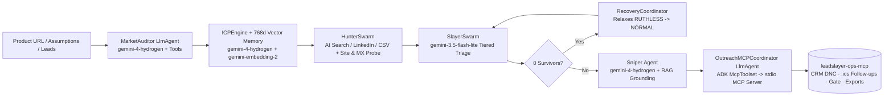

# LeadSlayer AI — Autonomous Adversarial GTM Engine

> **Track:** Automating Boring Stuff · **Stack:** Google ADK 2.0 + Gemini API + Model Context Protocol (MCP) + FastAPI + Next.js

LeadSlayer AI replaces repetitive, error-prone outbound sales prep—manual market research, lead list enrichment, junk lead filtering, MX deliverability verification, personalized drafting, follow-up scheduling, and audit reporting—with an autonomous multi-agent system that **aggressively disqualifies ~84% of bad-fit leads before a single email leaves your domain**.

---

## Problem Statement

Founders and lean GTM teams waste hours researching accounts, checking email deliverability, and reviewing spreadsheets—or worse, connect generic AI mailers that spam entire lead lists and destroy sender domain reputation.

LeadSlayer AI flips outbound automation from *"email everyone"* to **adversarial qualification + evidence-backed precision**.

---

## Architecture & Google AI Ecosystem



### Strict 3-Model Routing
| Role | Model | Purpose |
|---|---|---|
| **Heavy Reasoning & Tool Orchestration** | `gemini-4-hydrogen` | Market Auditor (adaptive tool use), ICP Architect, Sniper Drafting & Resurrect, MCP Action Coordinator |
| **High-Volume Triage & Enrichment** | `gemini-3.5-flash-lite` | Hunt query generation, sparse CSV enrichment, 50-lead adversarial Slayer triage |
| **Semantic Vector Memory** | `gemini-embedding-2` | 768-dimensional MRL embeddings for Dual-Polarity scoring (`60% ICP + 25% Structural - 15% Anti-ICP`) |

---

## MCP Server & Autonomous Agent Decisions

LeadSlayer exposes a real stdio **Model Context Protocol (MCP)** server (`backend/app/mcp_server.py`, server name `leadslayer-ops-mcp`) wired directly into Google ADK via `McpToolset` (`google.adk.tools.mcp_tool.mcp_toolset.McpToolset`).

| Agent Decision | Condition / Reasoning | MCP Tool Called |
|---|---|---|
| **CRM / Do-Not-Contact Guard** | Before staging any survivor email, verify domain is not an existing customer, competitor, or opted-out domain | `check_and_update_dnc_crm` |
| **High-Urgency Follow-up Scheduling** | Survivor exhibits urgent buying signal (`qualification_score >= 82`) | `schedule_followup_reminder` (writes `followups.json` + `.ics` calendar invite) |
| **Deliverability-Gated Staging / Send** | CRM-clear survivor has an evidence-grounded draft | `stage_or_dispatch_email_mcp` |
| **Campaign Deliverables Export** | Pipeline finishes triage & drafting | `save_campaign_artifacts` (writes `executive_brief.md`, CSV & JSON under `exports/<run_id>/`) |

All agent tool decisions and MCP tool call results stream live to the Command Center UI via Server-Sent Events (`mcp_tool_call`).

---

## Autonomous & Adaptive Behaviors
* **Adaptive Market Research (`MarketAuditor`):** An ADK `LlmAgent` with `FunctionTool`s inspects `product_url`; if a site is unreachable or returns thin copy, the agent autonomously pivots to Google Search grounding (`search_market_intel`).
* **Multi-Source Lead Discovery & Live Verification (`HunterSwarm`):** Supports `AI_SEARCH`, `LINKEDIN_SEARCH`, and `CSV_PRESET` uploads, performing live website crawling, ATS job-board detection, DNS MX validation, and Dual-Polarity NumPy vector scoring.
* **Self-Healing Zero-Survivor Recovery (`RecoveryCoordinatorADKAgent`):** If `RUTHLESS` mode eliminates 100% of leads, the coordinator diagnoses the top rejection bottleneck and automatically relaxes to `NORMAL` mode to recover viable buyers.
* **Human-in-the-Loop Resurrect & Native Mailbox Connection:** Click any killed lead in the **Autopsy Drawer** to inspect why it was rejected or click **Resurrect** to draft a grounded email on demand. Connect your own sender email via the UI (**Safe Sandbox**, **Live SMTP / Gmail App Password**, or **Gmail OAuth2**).

---

## Quickstart & Running Instructions

### 1. Prerequisites
* Python `3.11+` (project venv uses `backend/.venv`)
* Node.js `20+` & `npm`
* A Google Gemini API key (`GEMINI_API_KEY`)

### 2. Environment Setup
```bash
cp .env.example .env
# Edit .env and set GEMINI_API_KEY=your_key_here
```

### 3. Install Dependencies & Build Frontend
```bash
# Backend virtualenv
python3 -m venv backend/.venv
backend/.venv/bin/pip install -r backend/requirements.txt

# Frontend build
cd frontend
npm install
npm run build
cd ..
```

### 4. Start the Application
```bash
./start_demo.sh
```
* **Command Center UI:** `http://localhost:3000`
* **Recorded Demo Replay Mode:** `http://localhost:3000/?mode=replay` *(or toggle directly in the top header pill)*
* **Backend API Docs:** `http://127.0.0.1:8000/docs`

### 5. Demo Access & Preloaded Presets
* Click **`KubeGuard AI (50 Leads)`** for the full 50-lead Cloud FinOps adversarial bloodbath, or **`Orbix Packaging (15 Leads)`** to test a physical B2B custom packaging manufacturer (`orbixpackaging.com`).
* Keep **Safe Sandbox ($0 Demo)** selected during evaluation to validate compliance gates and MCP artifacts safely without sending external emails; optionally click **Connect Email** in the Sniper Deck to test live SMTP delivery to your own inbox.

---

## Running Tests

```bash
# Run full backend unit, MCP stdio, ADK tool & E2E replay test suite
PYTHONPATH=backend backend/.venv/bin/pytest -v backend/tests/

# Verify frontend production build & lint
cd frontend && npm run build && npm run lint
```
